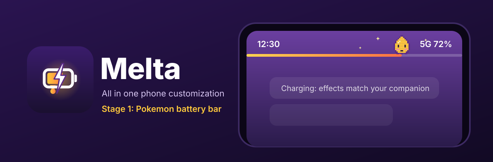

<p align="center">
  
</p>

<p align="center">
  <a href="https://github.com/Srimi1/melta/actions/workflows/android.yml"></a>
  
  
  
  <a href="LICENSE"></a>
</p>

# Melta

Melta is an all in one Android app for making your phone feel like yours. It is built in stages, one
customization module at a time. **Stage 1 is the Battery Bar**: a slim battery level bar across your
status bar with a Pokémon companion sitting on it, reacting when you plug in.

## Stage 1: Battery Bar

| | |
|---|---|
| **Every Pokémon, offline** | All 1025 Pokémon are built into the app, normal and shiny, so the picker works with no internet. Pikachu leads the Popular row. Search by name, number or type. Gen 1 to 5 can also use animated sprites, downloaded once on first use. |
| **Made to fit the bar** | Every sprite is trimmed and scaled in whole pixel steps, so the art stays sharp at any size. Choose "Same height" for every companion or "True size" to keep Pichu smaller than Snorlax. The bar can take its colors from your companion, like a yellow bar for Pikachu. |
| **Sits on your battery** | The companion rides the tip of the battery level, or parks left, center or right. It gently bounces while idle. |
| **Charging effects** | Plug in and the bar starts flowing with a shine sweep, plus particles that match your companion's type: thunder for Electric, flames for Fire, bubbles for Water, leaves for Grass, hearts for Fairy, snow for Ice, sparks for the rest. Or pick any effect yourself. |
| **Full charge celebration** | At 100% your companion spins around and bursts with joy. |
| **Low battery mood** | Below your warning level the bar turns red and the companion looks tired. |
| **Make your own** | A built in pixel art editor (16, 24 or 32 px) with pen, eraser, bucket fill, mirror mode and undo. Save your art as a companion that sits on the bar, or as a tiling pattern for the bar fill. You can also import any photo and touch it up as pixel art. |
| **Bar styling** | Solid, gradient, rainbow, stripes, dots, checker or your own pattern. Thickness, opacity, colors and position are all adjustable. |
| **Stays out of the way** | Never blocks taps, hides in landscape and fullscreen apps, and stops animating when the screen is off. |

## Screenshots

Real captures from an Android 14 emulator, made by the [Screenshots workflow](.github/workflows/screenshots.yml).

| Home | Battery Bar settings | Pick a companion |
|---|---|---|
|  |  |  |

| Make your own | On your phone, charging | Low battery |
|---|---|---|
|  |  |  |

| No permission? Notification panel | Stage 2: Shade settings | Themed card in the shade |
|---|---|---|
|  |  |  |

| Melta Shade |
|---|
|  |

## Stage 2: Notification Shade

Android does not let apps restyle the system shade without root, so Melta upgrades it from the inside,
with **no special permissions**:

| | |
|---|---|
| **Companion card** | Your Pokémon riding the battery bar as a card in the pull down panel, with charge time remaining. Shown in both bar modes. |
| **Card themes** | System, Pokédex, Game Boy (with a green tinted sprite), Neon and Night. |
| **Quick Settings tiles** | *Companion* shows your Pokémon and battery level and turns the bar on or off. *Pokémon of the day* swaps in a new companion every day. Add them with one tap on Android 13+. |

### Melta Shade

Melta's own pull down shade. Swipe down on the top edge (left half, right half or the whole edge, your
choice) and it slides in, in your card theme:

* clock, date and your companion riding the battery bar
* quick toggles: Wi‑Fi, Internet, Bluetooth, flashlight, Do not disturb, auto rotate, sound, battery bar,
  screenshot, lock screen, and a shortcut to the system shade
* a brightness slider
* your notifications grouped by app: tap to open, swipe to dismiss, clear all

It needs three switches in Android settings, and Melta walks you through each one with a live checklist:
the Melta Shade accessibility service, notification access, and (optional) changing system settings for
brightness and rotation. **The accessibility service never reads your screen.** It listens to no events
and only draws Melta's own windows.

### Light on RAM and battery

The overlay was designed to be a "built in" feeling feature, not another heavy app.

* The overlay service uses **no Compose and no image library**. It is one plain `View` drawn with Canvas.
* The sprite is decoded once, trimmed and scaled to the bar height (a few KB in memory).
* Particles use a **fixed size pool allocated once**, so there is no garbage created per frame.
* Animation runs at 30 fps only while charging, 15 fps for the idle bounce, and **stops completely** when the
  screen turns off or the bar is hidden. Turn off the idle bounce and the bar only redraws when your battery
  level changes.
* No networking stack: sprites are fetched with a tiny `HttpURLConnection` helper and cached forever.

Check it yourself on a device:

```bash
adb shell dumpsys meminfo com.melta.app
```

## How it works

```
 Settings UI (Compose)  ──writes──▶  DataStore  ◀──observes──  BatteryOverlayService (foreground)
                                                                  │
            ACTION_BATTERY_CHANGED ──▶  level / charging ─────────┤
            SCREEN_ON / SCREEN_OFF ──▶  pause / resume ───────────┤
                                                                  ▼
                                       WindowManager overlay ──▶ BatteryBarView (Canvas)
                                                                  ├─ fill shader (FillPatterns)
                                                                  ├─ companion sprite (SpriteLoader)
                                                                  └─ ParticleSystem (ChargeEffects)
```

### Project layout

```
app/src/main/java/com/melta/app/
├── MainActivity.kt, MeltaApp.kt      app entry, tiny screen stack
├── home/                             module launcher (future stages plug in here)
├── core/prefs/                       BatteryBarConfig + DataStore backed SettingsStore
├── core/net/                         minimal download helper
└── battery/
    ├── service/                      foreground overlay service, boot receiver
    ├── overlay/                      BatteryBarView, particles, fill patterns
    ├── sprites/                      Pokédex index, sprite download, decode and trim
    ├── creations/                    pixel grid model and saved creations
    └── ui/                           settings, Pokémon picker, pattern editor
```

## Permissions

| Permission | Why |
|---|---|
| Display over other apps | Optional. Draws the bar on top of the status bar. The window is not touchable and never reads screen content. Without it, the bar shows in the notification panel instead. |
| Notifications | Needed for the notification panel bar, and Android requires a notification for the service that keeps the bar alive. It is silent. |
| Run at startup | Brings the bar back after a reboot, only if you had it on. |
| Internet | Only for the optional animated sprites. Each is downloaded once and cached on the device. |
| Accessibility (Melta Shade) | Optional. Catches the swipe on the top edge and draws Melta Shade above other apps. Reads nothing. |
| Notification access (Melta Shade) | Optional. Shows your notifications inside Melta Shade. Nothing is stored or sent anywhere. |
| Modify system settings | Optional. Brightness slider and auto rotate toggle in Melta Shade. |
| Do not disturb access | Optional. The Do not disturb toggle in Melta Shade. |

### "Display over other apps" is greyed out

Android 13 and newer lock this setting for apps installed from a browser or file manager
("Restricted setting"). Melta keeps working in the notification panel meanwhile. To unlock the
status bar mode:

1. Open **Settings > Apps > Melta** (or tap **Open App info** in Melta).
2. Tap the **⋮** menu in the top right corner, then **Allow restricted settings**.
3. Go back to Melta and tap **Grant permission**.

## Build and install

Requirements: Android Studio (Ladybug or newer) or the Android SDK with JDK 17.

```bash
git clone https://github.com/Srimi1/melta.git
cd melta
./gradlew assembleDebug           # APK at app/build/outputs/apk/debug/
./gradlew testDebugUnitTest       # unit tests
./gradlew installDebug            # install on a connected device
```

The build gathers every Pokémon sprite into the APK (`./gradlew spritePack`, about 2 MB). The
download is cached in `~/.gradle/caches/melta-sprites`, so it only happens once. Building offline?
Add `-Pmelta.skipSpritePack=true` and the app falls back to downloading sprites when needed.

No setup at all? Every push builds a debug APK in GitHub Actions. Open the latest
[Android CI run](https://github.com/Srimi1/melta/actions/workflows/android.yml) and download the
`melta-debug-apk` artifact. Tagging a commit `v*` publishes a release with the APK attached.

## Roadmap

Melta grows one module per stage. See [ROADMAP.md](ROADMAP.md) for details.

- [x] **Stage 1:** Pokémon Battery Bar
- [x] **Stage 2a:** Notification shade card themes and Quick Settings tiles
- [x] **Stage 2b:** Melta Shade, a full custom shade
- [ ] **Stage 3:** Lock screen companions and clocks
- [ ] **Stage 4:** Battery aware live wallpapers
- [ ] **Stage 5:** Icon studio

## Contributing

Ideas, bug reports and pull requests are welcome. Please read [CONTRIBUTING.md](CONTRIBUTING.md) first.

## Credits and disclaimer

* Pokémon names and type data come from [PokeAPI](https://pokeapi.co/) (BSD 3 Clause). Sprites come
  from the [PokeAPI sprites](https://github.com/PokeAPI/sprites) repository. They are gathered at build
  time into the APK. **This repository does not contain any Pokémon artwork.**
* Pokémon and Pokémon character names are trademarks of Nintendo, Creatures Inc. and GAME FREAK inc.
  Melta is an unofficial fan project, not affiliated with or endorsed by them, and is not sold.
* The Melta icon and the "Melty" mascot are original artwork, released with the code under the MIT license.

## License

[MIT](LICENSE) © 2026 Srimi1
